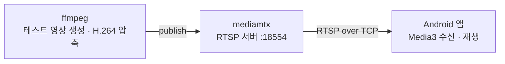

# RTSP Live Player Practice (Media3)

IP 카메라처럼 **원격 장비의 라이브 영상을 RTSP로 받아 Android 앱에서 안정적으로 재생**하는 구조를 직접 구현해본 실습 프로젝트입니다.

네트워크 영상 스트리밍 경험을 보완하기 위해 진행했으며, PC에 RTSP 서버로 가상 IP 카메라를 만들고 Media3(ExoPlayer)로 수신·재생하는 것부터 생명주기 처리, 자동 재연결, 상태 표시까지 구현했습니다.

<br>

## 구조



| 구성 | 역할 |
|---|---|
| ffmpeg | 카메라의 촬영·압축 역할. 테스트 영상을 H.264로 압축해 서버로 송출 |
| mediamtx | 카메라 내부의 RTSP 서버 역할. 접속한 클라이언트에 영상 제공 |
| Android 앱 | Media3 `RtspMediaSource`로 영상을 받아 재생 |

<br>

## 기술 스택

- Kotlin, Jetpack Compose
- AndroidX Media3 1.5.1 (`media3-exoplayer`, `media3-exoplayer-rtsp`, `media3-ui`)
- mediamtx, ffmpeg (테스트용 RTSP 서버와 송출)

<br>

## 구현 내용

### 1. RTSP 재생
- `ExoPlayer` + `RtspMediaSource`로 RTSP 스트림 수신
- XML 뷰인 `PlayerView`를 `AndroidView`로 Compose 화면에 배치
- `setForceUseRtpTcp(true)`: 에뮬레이터는 자체 NAT 뒤에 있어 PC에서 오는 UDP(RTP)를 받지 못하므로, 영상 데이터까지 TCP로 수신

### 2. 생명주기 처리
- 화면이 보이면(`ON_START`) `prepare()`, 안 보이면(`ON_STOP`) `stop()`
- 라이브 영상이므로 `pause()`가 아닌 `stop()` 사용
  - `pause()`는 연결을 유지해 돌아오면 과거 장면부터 이어짐
  - `stop()` 후 `prepare()`는 현재 시점으로 다시 연결
- 서버 로그에서 앱이 RTSP `TEARDOWN`으로 정상 종료하는 것 확인

### 3. 자동 재연결 (지수 백오프)
- 연결이 끊기면 1 → 2 → 4 → 8 → 16초 간격으로 재연결 시도, 연결되면 간격 초기화
- 화면이 안 보이면 예약된 재연결 취소
- **라이브 종료(ENDED) 처리**: 송출이 멈추면 플레이어가 에러가 아닌 `STATE_ENDED`로 전환되는 것을 테스트 중 발견
  - 라이브에서는 ENDED도 끊김으로 보고 재연결
  - ENDED 상태에서는 `prepare()`만으로 다시 연결되지 않아 `stop()` 후 `prepare()`로 새 RTSP 세션 생성

### 4. 상태 표시
- 연결 중(BUFFERING): 로딩 스피너 + "카메라에 연결하는 중..."
- 끊김(ENDED, ERROR): "연결이 끊겼어요. N초 후 다시 연결합니다 (시도 k)"
- 라이브 영상이므로 재생 컨트롤 숨김(`useController = false`)

<br>

## 트러블슈팅

### 에뮬레이터에서만 검은 화면 (포트 충돌)

**증상**
- 앱은 `BUFFERING`에서 멈추고 에러 없음
- RTSP 서버에는 앱의 연결 기록이 없음
- PC에서 `localhost`로 재생하면 정상

**원인을 좁혀간 과정**
1. 서버 로그 확인 → 앱의 연결 기록 없음 → 앱이 서버에 도착하지 못함
2. 에뮬레이터 브라우저로 같은 서버의 HLS(`10.0.2.2:8888`) 접속 → 정상 → 에뮬레이터와 PC 사이 네트워크는 문제없음
3. Media3 RTSP 디버그 로그 확인 → 첫 요청 `OPTIONS`만 보내고 응답 없음
4. PC에서 IPv4 주소(`127.0.0.1`)로 직접 접속 → 실패

**원인**
- PC의 IPv4 8554 포트를 다른 프로그램이 이미 사용 중
- PC 테스트는 `localhost`가 IPv6(`::1`)로 연결되어 정상이었지만, 에뮬레이터의 `10.0.2.2`는 PC의 IPv4로 들어와 다른 프로그램에 도착

**해결**
- RTSP 서버 포트를 18554로 변경

### 빌드 오류 (라이브러리 버전 불일치)
- 새 프로젝트 템플릿의 최신 라이브러리가 더 높은 AGP와 compileSdk를 요구하고, 더 새로운 Kotlin으로 빌드되어 있어 컴파일러가 클래스를 읽지 못함
- Kotlin 2.0.21에 맞춰 core, lifecycle, activity, Media3 버전을 같은 세대로 맞춰 해결

<br>

## 실행 방법

1. mediamtx 설정(`mediamtx.yml`)에서 RTSP 포트 변경 후 실행
   ```yaml
   rtspAddress: :18554
   ```

2. ffmpeg로 테스트 영상 송출
   ```
   ffmpeg -re -f lavfi -i testsrc=size=1280x720:rate=30 -c:v libx264 -preset ultrafast -tune zerolatency -pix_fmt yuv420p -g 30 -f rtsp rtsp://localhost:18554/test
   ```
   | 옵션 | 의미 |
   |---|---|
   | `-preset ultrafast -tune zerolatency` | 실시간 송출을 위한 저지연 압축 |
   | `-pix_fmt yuv420p` | Android 하드웨어 디코더가 지원하는 색 형식 |
   | `-g 30` | 1초마다 키프레임 (기본값은 약 8초라 처음 화면이 늦게 나옴) |

3. Android 에뮬레이터에서 앱 실행 (주소: `rtsp://10.0.2.2:18554/test`)

<br>

## 개선 계획

- 재연결 로직과 화면 상태를 ViewModel로 분리하고 UiState로 노출
- 지수 백오프에 무작위 지연(jitter)을 더해 동시 재연결 분산
- 데이터가 일정 시간 들어오지 않는 BUFFERING 상태 감지
- 일정 횟수 실패 후 사용자에게 "다시 시도" 버튼 제공
- 같은 네트워크의 실기기에서 UDP 수신 동작 확인
